# ERD — Danh sách vẽ (đã dedupe)

## Quy ước

- Mỗi dòng là **1 quan hệ**: `Parent (1) ──< N Child`.
- Vẽ **gạch đơn (|)** ở đầu Parent, **chân quạ (crow's foot)** ở đầu Child.
- Không có quan hệ **1:1**.
- **N:N** đi qua bảng trung gian (xem mục cuối).

## 1. 46 bảng theo domain

**Auth** (5): `users`, `roles`, `permissions`, `role_permissions`, `refresh_tokens`
**Horse** (6): `horses`, `horse_pedigrees`, `horse_health_metrics`, `horse_body_regions`, `horse_edit_requests`, `horse_edit_request_documents`
**Training** (8): `courses`, `exercises`, `course_exercises`, `course_runs`, `training_groups`, `training_group_members`, `training_sessions`, `training_workouts`
**Admission** (3): `admission_applications`, `candidate_horse_profiles`, `admission_documents`
**Veterinary** (7): `health_records`, `health_conditions`, `treatment_plans`, `prescriptions`, `preventive_protocols`, `care_schedule`, `medical_symptom_mappings`
**Groom** (5): `groom_profiles`, `groom_daily_tasks`, `groom_task_completions`, `groom_task_completion_photos`, `horse_incident_reports`
**Stable** (2): `areas`, `stable_stalls`
**Racing** (1): `racing_readiness_assessments`
**Profiles** (2): `veterinarian_profiles`, `trainer_profiles`
**AI & System** (7): `notifications`, `audit_logs`, `pending_agent_actions`, `ai_conversations`, `ai_chat_messages`, `rag_knowledge_documents`, `rag_knowledge_embeddings`

## 2. 76 quan hệ 1:N (parent → child)

| # | Parent (1) | Child (N) |
|---:|---|---|
| 1 | `admission_applications` | `admission_documents` |
| 2 | `admission_applications` | `candidate_horse_profiles` |
| 3 | `admission_applications` | `care_schedule` |
| 4 | `admission_applications` | `racing_readiness_assessments` |
| 5 | `ai_conversations` | `ai_chat_messages` |
| 6 | `areas` | `stable_stalls` |
| 7 | `care_schedule` | `health_records` |
| 8 | `care_schedule` | `horse_incident_reports` |
| 9 | `course_exercises` | `training_sessions` |
| 10 | `course_exercises` | `training_workouts` |
| 11 | `course_runs` | `training_sessions` |
| 12 | `courses` | `course_exercises` |
| 13 | `courses` | `course_runs` |
| 14 | `exercises` | `course_exercises` |
| 15 | `exercises` | `training_sessions` |
| 16 | `exercises` | `training_workouts` |
| 17 | `groom_task_completions` | `groom_daily_tasks` |
| 18 | `groom_task_completions` | `groom_task_completion_photos` |
| 19 | `health_records` | `health_conditions` |
| 20 | `health_records` | `horse_health_metrics` |
| 21 | `health_records` | `treatment_plans` |
| 22 | `horse_body_regions` | `health_conditions` |
| 23 | `horse_edit_requests` | `horse_edit_request_documents` |
| 24 | `horses` | `admission_applications` |
| 25 | `horses` | `care_schedule` |
| 26 | `horses` | `groom_daily_tasks` |
| 27 | `horses` | `health_conditions` |
| 28 | `horses` | `health_records` |
| 29 | `horses` | `horse_edit_request_documents` |
| 30 | `horses` | `horse_edit_requests` |
| 31 | `horses` | `horse_health_metrics` |
| 32 | `horses` | `horse_incident_reports` |
| 33 | `horses` | `horse_pedigrees` |
| 34 | `horses` | `racing_readiness_assessments` |
| 35 | `horses` | `training_group_members` |
| 36 | `horses` | `training_sessions` |
| 37 | `horses` | `training_workouts` |
| 38 | `permissions` | `role_permissions` |
| 39 | `preventive_protocols` | `prescriptions` |
| 40 | `rag_knowledge_documents` | `rag_knowledge_embeddings` |
| 41 | `roles` | `role_permissions` |
| 42 | `roles` | `users` |
| 43 | `stable_stalls` | `admission_applications` |
| 44 | `stable_stalls` | `horses` |
| 45 | `training_groups` | `course_runs` |
| 46 | `training_groups` | `training_group_members` |
| 47 | `training_sessions` | `health_records` |
| 48 | `training_sessions` | `training_workouts` |
| 49 | `training_workouts` | `health_records` |
| 50 | `treatment_plans` | `prescriptions` |
| 51 | `users` | `admission_applications` |
| 52 | `users` | `ai_conversations` |
| 53 | `users` | `areas` |
| 54 | `users` | `audit_logs` |
| 55 | `users` | `care_schedule` |
| 56 | `users` | `course_runs` |
| 57 | `users` | `courses` |
| 58 | `users` | `exercises` |
| 59 | `users` | `groom_daily_tasks` |
| 60 | `users` | `groom_profiles` |
| 61 | `users` | `groom_task_completions` |
| 62 | `users` | `health_records` |
| 63 | `users` | `horse_edit_requests` |
| 64 | `users` | `horse_incident_reports` |
| 65 | `users` | `horses` |
| 66 | `users` | `notifications` |
| 67 | `users` | `pending_agent_actions` |
| 68 | `users` | `racing_readiness_assessments` |
| 69 | `users` | `refresh_tokens` |
| 70 | `users` | `stable_stalls` |
| 71 | `users` | `trainer_profiles` |
| 72 | `users` | `training_group_members` |
| 73 | `users` | `training_groups` |
| 74 | `users` | `training_sessions` |
| 75 | `users` | `training_workouts` |
| 76 | `users` | `veterinarian_profiles` |

## 3. 4 cặp N:N (qua bảng trung gian)

| A | B | Qua bảng |
|---|---|---|
| `roles` | `permissions` | `role_permissions` |
| `courses` | `exercises` | `course_exercises` |
| `courses` | `training_groups` | `course_runs` |
| `training_groups` | `horses` | `training_group_members` |

## 4. Mermaid (dán vào draw.io: Arrange → Insert → Mermaid)

```mermaid
erDiagram
  admission_applications ||--o{ admission_documents : "fk"
  admission_applications ||--o{ candidate_horse_profiles : "fk"
  admission_applications ||--o{ care_schedule : "fk"
  admission_applications ||--o{ racing_readiness_assessments : "fk"
  ai_conversations ||--o{ ai_chat_messages : "fk"
  areas ||--o{ stable_stalls : "fk"
  care_schedule ||--o{ health_records : "fk"
  care_schedule ||--o{ horse_incident_reports : "fk"
  course_exercises ||--o{ training_sessions : "fk"
  course_exercises ||--o{ training_workouts : "fk"
  course_runs ||--o{ training_sessions : "fk"
  courses ||--o{ course_exercises : "fk"
  courses ||--o{ course_runs : "fk"
  exercises ||--o{ course_exercises : "fk"
  exercises ||--o{ training_sessions : "fk"
  exercises ||--o{ training_workouts : "fk"
  groom_task_completions ||--o{ groom_daily_tasks : "fk"
  groom_task_completions ||--o{ groom_task_completion_photos : "fk"
  health_records ||--o{ health_conditions : "fk"
  health_records ||--o{ horse_health_metrics : "fk"
  health_records ||--o{ treatment_plans : "fk"
  horse_body_regions ||--o{ health_conditions : "fk"
  horse_edit_requests ||--o{ horse_edit_request_documents : "fk"
  horses ||--o{ admission_applications : "fk"
  horses ||--o{ care_schedule : "fk"
  horses ||--o{ groom_daily_tasks : "fk"
  horses ||--o{ health_conditions : "fk"
  horses ||--o{ health_records : "fk"
  horses ||--o{ horse_edit_request_documents : "fk"
  horses ||--o{ horse_edit_requests : "fk"
  horses ||--o{ horse_health_metrics : "fk"
  horses ||--o{ horse_incident_reports : "fk"
  horses ||--o{ horse_pedigrees : "fk"
  horses ||--o{ racing_readiness_assessments : "fk"
  horses ||--o{ training_group_members : "fk"
  horses ||--o{ training_sessions : "fk"
  horses ||--o{ training_workouts : "fk"
  permissions ||--o{ role_permissions : "fk"
  preventive_protocols ||--o{ prescriptions : "fk"
  rag_knowledge_documents ||--o{ rag_knowledge_embeddings : "fk"
  roles ||--o{ role_permissions : "fk"
  roles ||--o{ users : "fk"
  stable_stalls ||--o{ admission_applications : "fk"
  stable_stalls ||--o{ horses : "fk"
  training_groups ||--o{ course_runs : "fk"
  training_groups ||--o{ training_group_members : "fk"
  training_sessions ||--o{ health_records : "fk"
  training_sessions ||--o{ training_workouts : "fk"
  training_workouts ||--o{ health_records : "fk"
  treatment_plans ||--o{ prescriptions : "fk"
  users ||--o{ admission_applications : "fk"
  users ||--o{ ai_conversations : "fk"
  users ||--o{ areas : "fk"
  users ||--o{ audit_logs : "fk"
  users ||--o{ care_schedule : "fk"
  users ||--o{ course_runs : "fk"
  users ||--o{ courses : "fk"
  users ||--o{ exercises : "fk"
  users ||--o{ groom_daily_tasks : "fk"
  users ||--o{ groom_profiles : "fk"
  users ||--o{ groom_task_completions : "fk"
  users ||--o{ health_records : "fk"
  users ||--o{ horse_edit_requests : "fk"
  users ||--o{ horse_incident_reports : "fk"
  users ||--o{ horses : "fk"
  users ||--o{ notifications : "fk"
  users ||--o{ pending_agent_actions : "fk"
  users ||--o{ racing_readiness_assessments : "fk"
  users ||--o{ refresh_tokens : "fk"
  users ||--o{ stable_stalls : "fk"
  users ||--o{ trainer_profiles : "fk"
  users ||--o{ training_group_members : "fk"
  users ||--o{ training_groups : "fk"
  users ||--o{ training_sessions : "fk"
  users ||--o{ training_workouts : "fk"
  users ||--o{ veterinarian_profiles : "fk"
```

