# ERD — Racehorse Training System

## 1. Tables (46)

### Auth (5)
- `users`
- `roles`
- `permissions`
- `role_permissions`
- `refresh_tokens`

### Horse (6)
- `horses`
- `horse_pedigrees`
- `horse_health_metrics`
- `horse_body_regions`
- `horse_edit_requests`
- `horse_edit_request_documents`

### Training (8)
- `courses`
- `exercises`
- `course_exercises`
- `course_runs`
- `training_groups`
- `training_group_members`
- `training_sessions`
- `training_workouts`

### Admission (3)
- `admission_applications`
- `candidate_horse_profiles`
- `admission_documents`

### Veterinary (7)
- `health_records`
- `health_conditions`
- `treatment_plans`
- `prescriptions`
- `preventive_protocols`
- `care_schedule`
- `medical_symptom_mappings`

### Groom (5)
- `groom_profiles`
- `groom_daily_tasks`
- `groom_task_completions`
- `groom_task_completion_photos`
- `horse_incident_reports`

### Stable (2)
- `areas`
- `stable_stalls`

### Racing (1)
- `racing_readiness_assessments`

### Profiles (2)
- `veterinarian_profiles`
- `trainer_profiles`

### AI & System (7)
- `notifications`
- `audit_logs`
- `pending_agent_actions`
- `ai_conversations`
- `ai_chat_messages`
- `rag_knowledge_documents`
- `rag_knowledge_embeddings`

## 2. Foreign keys (76) — child → parent (N:1)

Crow's foot: **many** at the child end, **one** (single tick) at the parent end.

### `admission_applications`
- `admission_applications`  }——  `horses`   (N:1)
- `admission_applications`  }——  `stable_stalls`   (N:1)
- `admission_applications`  }——  `users`   (N:1)

### `admission_documents`
- `admission_documents`  }——  `admission_applications`   (N:1)

### `ai_chat_messages`
- `ai_chat_messages`  }——  `ai_conversations`   (N:1)

### `ai_conversations`
- `ai_conversations`  }——  `users`   (N:1)

### `areas`
- `areas`  }——  `users`   (N:1)

### `audit_logs`
- `audit_logs`  }——  `users`   (N:1)

### `candidate_horse_profiles`
- `candidate_horse_profiles`  }——  `admission_applications`   (N:1)

### `care_schedule`
- `care_schedule`  }——  `admission_applications`   (N:1)
- `care_schedule`  }——  `horses`   (N:1)
- `care_schedule`  }——  `users`   (N:1)

### `course_exercises`
- `course_exercises`  }——  `courses`   (N:1)
- `course_exercises`  }——  `exercises`   (N:1)

### `course_runs`
- `course_runs`  }——  `courses`   (N:1)
- `course_runs`  }——  `training_groups`   (N:1)
- `course_runs`  }——  `users`   (N:1)

### `courses`
- `courses`  }——  `users`   (N:1)

### `exercises`
- `exercises`  }——  `users`   (N:1)

### `groom_daily_tasks`
- `groom_daily_tasks`  }——  `groom_task_completions`   (N:1)
- `groom_daily_tasks`  }——  `horses`   (N:1)
- `groom_daily_tasks`  }——  `users`   (N:1)

### `groom_profiles`
- `groom_profiles`  }——  `users`   (N:1)

### `groom_task_completion_photos`
- `groom_task_completion_photos`  }——  `groom_task_completions`   (N:1)

### `groom_task_completions`
- `groom_task_completions`  }——  `users`   (N:1)

### `health_conditions`
- `health_conditions`  }——  `health_records`   (N:1)
- `health_conditions`  }——  `horse_body_regions`   (N:1)
- `health_conditions`  }——  `horses`   (N:1)

### `health_records`
- `health_records`  }——  `care_schedule`   (N:1)
- `health_records`  }——  `horses`   (N:1)
- `health_records`  }——  `training_sessions`   (N:1)
- `health_records`  }——  `training_workouts`   (N:1)
- `health_records`  }——  `users`   (N:1)

### `horse_edit_request_documents`
- `horse_edit_request_documents`  }——  `horse_edit_requests`   (N:1)
- `horse_edit_request_documents`  }——  `horses`   (N:1)

### `horse_edit_requests`
- `horse_edit_requests`  }——  `horses`   (N:1)
- `horse_edit_requests`  }——  `users`   (N:1)

### `horse_health_metrics`
- `horse_health_metrics`  }——  `health_records`   (N:1)
- `horse_health_metrics`  }——  `horses`   (N:1)

### `horse_incident_reports`
- `horse_incident_reports`  }——  `care_schedule`   (N:1)
- `horse_incident_reports`  }——  `horses`   (N:1)
- `horse_incident_reports`  }——  `users`   (N:1)

### `horse_pedigrees`
- `horse_pedigrees`  }——  `horses`   (N:1)

### `horses`
- `horses`  }——  `stable_stalls`   (N:1)
- `horses`  }——  `users`   (N:1)

### `notifications`
- `notifications`  }——  `users`   (N:1)

### `pending_agent_actions`
- `pending_agent_actions`  }——  `users`   (N:1)

### `prescriptions`
- `prescriptions`  }——  `preventive_protocols`   (N:1)
- `prescriptions`  }——  `treatment_plans`   (N:1)

### `racing_readiness_assessments`
- `racing_readiness_assessments`  }——  `admission_applications`   (N:1)
- `racing_readiness_assessments`  }——  `horses`   (N:1)
- `racing_readiness_assessments`  }——  `users`   (N:1)

### `rag_knowledge_embeddings`
- `rag_knowledge_embeddings`  }——  `rag_knowledge_documents`   (N:1)

### `refresh_tokens`
- `refresh_tokens`  }——  `users`   (N:1)

### `role_permissions`
- `role_permissions`  }——  `permissions`   (N:1)
- `role_permissions`  }——  `roles`   (N:1)

### `stable_stalls`
- `stable_stalls`  }——  `areas`   (N:1)
- `stable_stalls`  }——  `users`   (N:1)

### `trainer_profiles`
- `trainer_profiles`  }——  `users`   (N:1)

### `training_group_members`
- `training_group_members`  }——  `horses`   (N:1)
- `training_group_members`  }——  `training_groups`   (N:1)
- `training_group_members`  }——  `users`   (N:1)

### `training_groups`
- `training_groups`  }——  `users`   (N:1)

### `training_sessions`
- `training_sessions`  }——  `course_exercises`   (N:1)
- `training_sessions`  }——  `course_runs`   (N:1)
- `training_sessions`  }——  `exercises`   (N:1)
- `training_sessions`  }——  `horses`   (N:1)
- `training_sessions`  }——  `users`   (N:1)

### `training_workouts`
- `training_workouts`  }——  `course_exercises`   (N:1)
- `training_workouts`  }——  `exercises`   (N:1)
- `training_workouts`  }——  `horses`   (N:1)
- `training_workouts`  }——  `training_sessions`   (N:1)
- `training_workouts`  }——  `users`   (N:1)

### `treatment_plans`
- `treatment_plans`  }——  `health_records`   (N:1)

### `users`
- `users`  }——  `roles`   (N:1)

### `veterinarian_profiles`
- `veterinarian_profiles`  }——  `users`   (N:1)

## 3. Mermaid ER (paste into draw.io: Arrange → Insert → Mermaid)

```mermaid
erDiagram
  horses ||--o{ admission_applications : "fk"
  stable_stalls ||--o{ admission_applications : "fk"
  users ||--o{ admission_applications : "fk"
  admission_applications ||--o{ admission_documents : "fk"
  ai_conversations ||--o{ ai_chat_messages : "fk"
  users ||--o{ ai_conversations : "fk"
  users ||--o{ areas : "fk"
  users ||--o{ audit_logs : "fk"
  admission_applications ||--o{ candidate_horse_profiles : "fk"
  admission_applications ||--o{ care_schedule : "fk"
  horses ||--o{ care_schedule : "fk"
  users ||--o{ care_schedule : "fk"
  courses ||--o{ course_exercises : "fk"
  exercises ||--o{ course_exercises : "fk"
  courses ||--o{ course_runs : "fk"
  training_groups ||--o{ course_runs : "fk"
  users ||--o{ course_runs : "fk"
  users ||--o{ courses : "fk"
  users ||--o{ exercises : "fk"
  groom_task_completions ||--o{ groom_daily_tasks : "fk"
  horses ||--o{ groom_daily_tasks : "fk"
  users ||--o{ groom_daily_tasks : "fk"
  users ||--o{ groom_profiles : "fk"
  groom_task_completions ||--o{ groom_task_completion_photos : "fk"
  users ||--o{ groom_task_completions : "fk"
  health_records ||--o{ health_conditions : "fk"
  horse_body_regions ||--o{ health_conditions : "fk"
  horses ||--o{ health_conditions : "fk"
  care_schedule ||--o{ health_records : "fk"
  horses ||--o{ health_records : "fk"
  training_sessions ||--o{ health_records : "fk"
  training_workouts ||--o{ health_records : "fk"
  users ||--o{ health_records : "fk"
  horse_edit_requests ||--o{ horse_edit_request_documents : "fk"
  horses ||--o{ horse_edit_request_documents : "fk"
  horses ||--o{ horse_edit_requests : "fk"
  users ||--o{ horse_edit_requests : "fk"
  health_records ||--o{ horse_health_metrics : "fk"
  horses ||--o{ horse_health_metrics : "fk"
  care_schedule ||--o{ horse_incident_reports : "fk"
  horses ||--o{ horse_incident_reports : "fk"
  users ||--o{ horse_incident_reports : "fk"
  horses ||--o{ horse_pedigrees : "fk"
  stable_stalls ||--o{ horses : "fk"
  users ||--o{ horses : "fk"
  users ||--o{ notifications : "fk"
  users ||--o{ pending_agent_actions : "fk"
  preventive_protocols ||--o{ prescriptions : "fk"
  treatment_plans ||--o{ prescriptions : "fk"
  admission_applications ||--o{ racing_readiness_assessments : "fk"
  horses ||--o{ racing_readiness_assessments : "fk"
  users ||--o{ racing_readiness_assessments : "fk"
  rag_knowledge_documents ||--o{ rag_knowledge_embeddings : "fk"
  users ||--o{ refresh_tokens : "fk"
  permissions ||--o{ role_permissions : "fk"
  roles ||--o{ role_permissions : "fk"
  areas ||--o{ stable_stalls : "fk"
  users ||--o{ stable_stalls : "fk"
  users ||--o{ trainer_profiles : "fk"
  horses ||--o{ training_group_members : "fk"
  training_groups ||--o{ training_group_members : "fk"
  users ||--o{ training_group_members : "fk"
  users ||--o{ training_groups : "fk"
  course_exercises ||--o{ training_sessions : "fk"
  course_runs ||--o{ training_sessions : "fk"
  exercises ||--o{ training_sessions : "fk"
  horses ||--o{ training_sessions : "fk"
  users ||--o{ training_sessions : "fk"
  course_exercises ||--o{ training_workouts : "fk"
  exercises ||--o{ training_workouts : "fk"
  horses ||--o{ training_workouts : "fk"
  training_sessions ||--o{ training_workouts : "fk"
  users ||--o{ training_workouts : "fk"
  health_records ||--o{ treatment_plans : "fk"
  roles ||--o{ users : "fk"
  users ||--o{ veterinarian_profiles : "fk"
```

